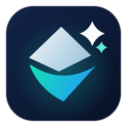
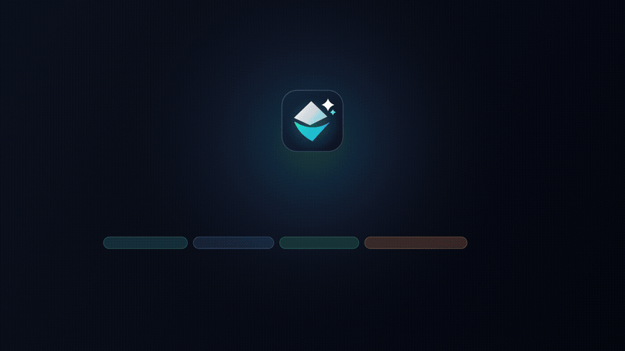
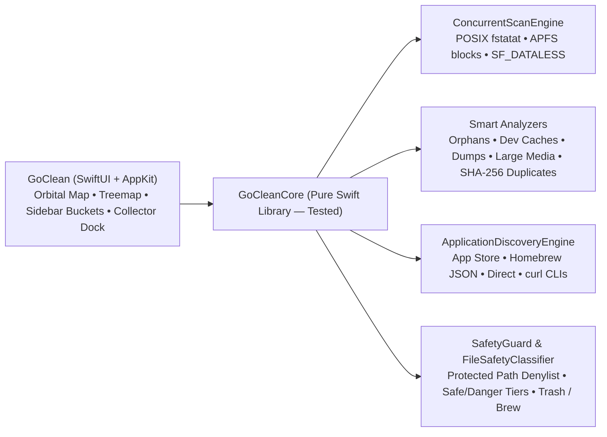

<div align="center">
  
  <h1>GoClean</h1>
  <p><strong>Native Swift 6 Disk Analyzer, Smart Cleanup Utility & Deep Uninstaller for macOS</strong></p>

  <p>
    
    
    
    
  </p>
  <p>
    <a href="https://codzze.github.io/goclean/"><strong>✨ Explore the Interactive App Portal (GitHub Pages) →</strong></a>
  </p>
</div>

> [!CAUTION]
> **Clean at your own risk.** Deleting system, `~/Library`, or application files can cause macOS instability or permanent data loss. GoClean marks files with **Safe / Likely Safe / Review / Danger** badges, enforces a `SafetyGuard` protected-path denylist, and defaults to reversible **Move to Trash**, but you are responsible for reviewing every item before removing it.

---

## Demo & Explainer Video

<div align="center">
  
  <p>
    <a href="docs/goclean-demo.mp4"><strong>▶ Watch Full 720p Explainer Video (MP4)</strong></a>
  </p>
</div>

---

## Why GoClean?

Inspired by the speed and visual clarity of **DaisyDisk** and **SquirrelDisk**, **GoClean** is built from scratch in **100% native Swift 6 + SwiftUI + AppKit** with zero third-party dependencies — combining an interactive **Luminous Orbital Map** with dedicated sidebar workflows for the exact cleanup tasks macOS developers and power users run into every week.

### Core Capabilities

| Feature | What It Does |
| --- | --- |
| **Luminous Orbital Map + Treemap + List** | Concurrent POSIX (`opendir`/`readdir`/`fstatat`) APFS scanner measuring true physical allocated blocks (`st_blocks * 512`), ignoring dataless iCloud/FileProvider placeholders (`SF_DATALESS`), deduplicating hard links `(st_dev, st_ino)`, and streaming live results into interactive concentric orbital rings with hover telemetry and Quick Look (`Space`). |
| **Orphaned App Data** | Indexes all installed `.app` bundles & CLI tools, scans `~/Library/{Application Support, Caches, Containers, Preferences, Saved Application State, HTTPStorages, WebKit, Logs, LaunchAgents}`, protects Apple/system identifiers, and groups deleted-app leftovers with confidence badges. |
| **Dev & App Caches** | Finds dormant `node_modules` (with age badges), `.next`/`.nuxt`, Xcode `DerivedData`, SwiftPM `.build`, Rust `target/` (verified by `Cargo.toml`), CocoaPods `Pods`, Gradle, Python `.venv`/`__pycache__`, global package caches (Homebrew, npm, pnpm, yarn, bun, pip, uv, cargo, go), and `~/Library/Caches`. |
| **Dump & System Junk** | Surfaces crash/core/heap dumps (`.ips`, `.crash`, `.dmp`, `.core`, `.hprof`), old `.dmg`/`.pkg` installers in Downloads/Desktop, Xcode DeviceSupport/Archives, and bulky app logs. |
| **Large Videos & Media** | Finds oversized videos & large user files with async Quick Look thumbnails (`QLThumbnailGenerator`), configurable size thresholds, and instant preview — hiding macOS system & Library files by default (and flagging them **Danger** if toggled on). |
| **3-Stage Duplicate Files** | Exact size grouping → 16 KB head+tail partial hash → full streaming `CryptoKit` SHA-256 verification. Automatically ignores APFS hard links and includes **Smart Select** strategies (`Keep Oldest`, `Keep Newest`, `Keep Shortest Path`) guaranteed to preserve at least one copy. |
| **Unified Application Manager** | Discovers & deeply uninstalls apps across **Mac App Store** (`_MASReceipt`), **Homebrew Casks & Formulae** (with live reverse-dependency warnings and `brew uninstall --cask --zap`), **Direct / DMG** `.app` bundles, and **Direct `curl` / User CLI tools** alongside all associated `~/Library` & config files. |
| **Safe-by-Default Collector Dock** | Stage items from any view into the bottom Collector tray. Enforces a non-bypassable `SafetyGuard` protected-path denylist, defaults to reversible **Move to Trash**, and gates **Permanent Erase** behind an explicit confirmation dialog. |
| **Dark / Light / System Appearance** | Native toolbar switcher synchronized cleanly across titlebar, sidebar, glass surfaces, and Orbital Map. |

---

## Safety Classification

Every item across GoClean's Smart Cleanup categories is classified by `FileSafetyClassifier`:

- **Safe** (Emerald): No-impact files that are automatically recreated or verified redundant (regenerable caches, crash dumps, dormant `node_modules`, verified duplicate copies, high-confidence orphaned leftovers).
- **Likely Safe / Review** (Teal / Amber): User-owned files, installers, or Xcode Archives — preview before deleting.
- **Danger** (Crimson): System/OS/protected paths (`/System`, `/usr`, `/Library`, `~/Library/Keychains`, bundles) or Homebrew formulae required by other installed packages. Critical OS roots are strictly blocked from deletion by `SafetyGuard`.

---

## Architecture



---

## Quick Start

### Requirements
- **macOS 15.0+** (Apple Silicon or Intel)
- **Xcode 16+** / Swift 6 toolchain

### Build, Test & Launch

```bash
# 1. Clone the repository
git clone https://github.com/codzze/goclean.git
cd goclean

# 2. Run the unit test suite (GoCleanCoreTests)
swift test

# 3. Build, package, and ad-hoc sign build/GoClean.app (includes Retina AppIcon.icns)
./scripts/bundle_app.sh

# 4. Launch GoClean
open build/GoClean.app
```

### Granting Full Disk Access (Optional, Recommended)
Because locally built macOS apps aren't pre-listed in Privacy settings:
1. Click **Reveal App** on GoClean's Overview banner (or **Enable Full Disk Access…** in the sidebar footer).
2. Click **Open Settings** to jump to *System Settings → Privacy & Security → Full Disk Access*.
3. Drag `GoClean.app` from Finder into the list (or click **`+`**), toggle it **ON**, and relaunch GoClean.

---

## Project Layout

```text
goclean/
├── Package.swift
├── scripts/
│   └── bundle_app.sh          # Release build + CoreGraphics Retina .icns + ad-hoc codesign
├── Sources/
│   ├── GoCleanCore/           # Pure Swift engine (Models, Scanner, Analyzers, Apps, Safety)
│   └── GoClean/               # Native SwiftUI + AppKit UI (Orbital Map, Buckets, Collector)
├── Tests/
│   └── GoCleanCoreTests/      # Unit tests for scanner, SafetyGuard, analyzers, duplicates & apps
└── docs/                      # GitHub Pages interactive app portal + demo media
    ├── index.html             # Animated GitHub Pages portal (https://codzze.github.io/goclean/)
    ├── styles.css
    ├── app.js
    ├── logo.png
    ├── goclean-demo.gif
    ├── goclean-demo.mp4
    └── screenshots/           # Clean synthetic Retina showcase screenshots
```

## License

MIT — see [LICENSE](LICENSE).
